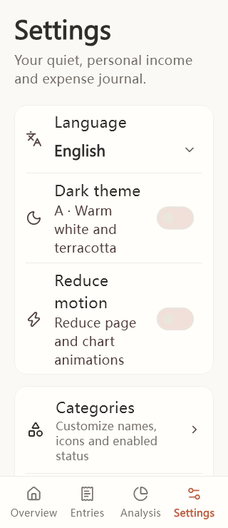
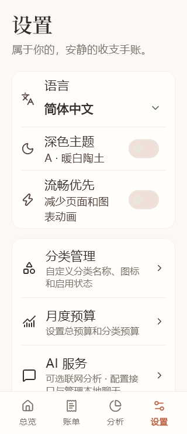
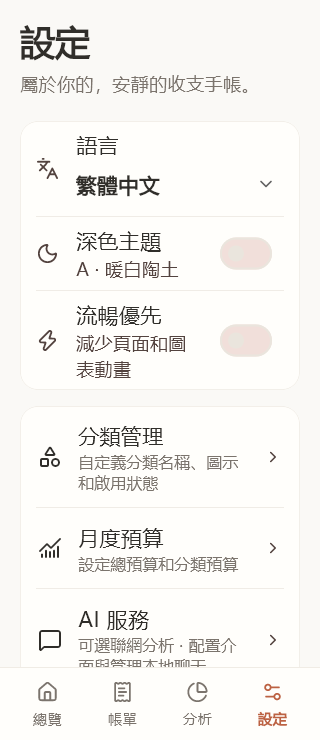
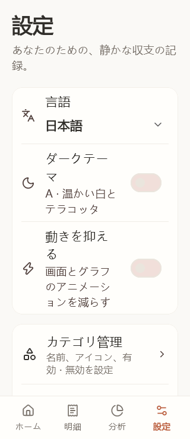

# 语言切换

负责人 ace865 / Codex，基于主分支 `84d9158`，分支 `codex/four-languages`，关联[任务 #28](https://github.com/ace865/jianzhang/issues/28)。本次只提交功能 PR，由 songyu00yo 审查合并，不发布安装包或标签。应用版本仍为 `1.3.0+8`，未分配新的分发构建号。

## 使用方式

在“设置 → 语言”选择跟随系统、English、简体中文、繁體中文或日本語。立即生效并在重启后保留，保留当前导航和记账草稿；跟随系统时响应系统语言变化。语言名称始终使用自身写法。

系统首选语言列表依次匹配英语、日语或中文；中文明确文字体系优先，繁体及台湾/香港/澳门使用繁体，其他中文使用简体，全部无法匹配则使用简体。繁体文案采用台湾常用表达。应用名称保持“简账”。

语言偏好以独立的 `jianzhang.ui.language` 安全存储键保存，读取失败回退跟随系统，写入失败保留旧选择并提示。语言不进入账本设置表、JSON 备份或 AI 记录密钥，不随账本恢复被替换。

## 数据与 AI 边界

- 日期和界面提示跟随语言。金额仍是人民币，整数分存储、两位小数输入和计算不变，日语界面不切换日元；CSV 列、JSON 格式和存储日期保持兼容。
- 默认分类只在 ID 和原始默认名称同时匹配时翻译显示。自定义/改名分类、备注、小记及微信原文件内容保持原文。支付方式只翻译标签，写入、筛选和导入去重仍用原始值，不自动重写旧账。分类搜索同时匹配翻译后的内置显示名称，按原 ID 查询，汇总、分页和筛选导出使用相同条件。
- 应用界面、导入系统提示、AI 设置/错误/无障碍标签及日期选择器本地化。未知异常显示通用提示，不把原始异常信息交给用户；部分账本校验提供稳定错误类型，旧核心消息在显示边界兼容翻译。
- 新报告和追问请求明确指定发送时的语言；预览与实际请求使用同一语言。切换不触发网络请求，不改变已发出的请求、不翻译旧报告/聊天。模型目录的官方 ID 与服务端原始名称保留，内置品牌说明可翻译。
- 会话增加可选 `language` 字段，旧记录缺省 `zh-Hans`。报告缓存按语言匹配，不跨语言复用旧报告；历史会话中的新追问可使用当前语言，原报告及原回复不改写。加密机制、账本快照结构及隐私发送范围不变。
- 使用现有 Flutter 本地化组件、ARB 和 `gen_l10n`；字体在繁体、日语和英语时使用平台字形回退，保持原双主题。设备系统文件选择器的操作与可用语言仍由平台控制，应用传入的对话框标题按所选语言显示。

## 验证范围

Windows / Flutter 3.47.6 / Dart 3.13.5。本地完成：锁文件校验、格式、静态分析；四语言双主题 320×740、1.3 倍字体的设置与编辑器测试；草稿保留、系统变化/手动覆盖、偏好重启与读写失败、翻译键/占位符完整性；原值保存、旧备份恢复、未知异常保护；模拟 AI 缓存隔离、旧历史读取、当前语言发送及切换无自动请求。本地完整 159 项测试通过（原 138 项，新增 21 项语言回归），格式和静态分析无问题，Android debug 构建通过。iOS 构建及远端最终结果以 PR 最新提交的 GitHub 检查为准。新增语言回归同时核对四语言下保存的原值、旧备份恢复、译名搜索及筛选汇总。

Android debug 构建通过，仅用于构建验证，不作为分发包；SDK 工具 XML 版本提示未阻断构建。iOS 由 macOS CI 执行无签名构建，本地 Windows 无法完成该检查。未连接手机或运行模拟器，系统安全存储/文件选择器、系统字体在真实 Android/iPhone 上的字形与切换体验仍需真机验证；没有真实服务商调用和性能测量。自动渲染不代表真机或人工母语审校通过。

语言测试中的样例账本与 AI 服务均为虚构数据。截图输出到 `output/test-artifacts/languages/`，不会进入发行包。

## 界面渲染

以下为测试生成的 320×740、1.3 倍字体设置页，使用虚构账本，不是真机截图。

| English | 简体中文 | 繁體中文 | 日本語 |
| --- | --- | --- | --- |
|  |  |  |  |
